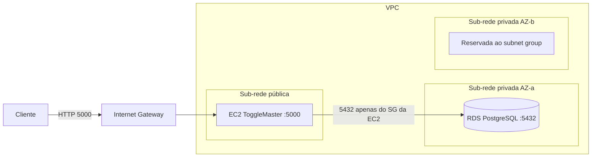

# Arquitetura — ToggleMaster Fase 1

## Por que esta aplicação é um monolito

O MVP é um único processo Python. Rotas HTTP, validação, SQL e a criação da tabela `flags` estão em `app.py`. O `Dockerfile` gera uma imagem só, e o `entrypoint.sh` espera o Postgres, roda `flask init-db` e sobe o Gunicorn no mesmo container.

Não há serviços separados para API, autenticação ou avaliação de flag. Um deploy publica a plataforma inteira.

Para um MVP isso é uma vantagem: um repositório, um processo e um banco. O time sobe a API rápido, depura em um lugar só e valida a ideia de feature flag antes de separar componentes.

O limite aparece quando o uso cresce. Escalar a API escala o processo inteiro. Uma falha no processo tira a API do ar. Cada mudança passa pelo mesmo artefato. Times diferentes não conseguem evoluir partes da plataforma com ciclos próprios. As fases seguintes do curso partem deste MVP para um sistema distribuído.

O código entregue cobre criar, listar, consultar e atualizar flags (`POST`, `GET` e `PUT` em `/flags`). Não há rota `DELETE`.

## Desenho na AWS

A EC2 fica na sub-rede pública e recebe o tráfego da API na porta 5000. O RDS PostgreSQL fica em sub-rede privada, sem IP público. A EC2 abre a conexão com o banco. O banco não inicia conexão de volta.

A AWS exige subnet group com sub-redes em pelo menos duas zonas de disponibilidade, mesmo com RDS single-AZ. O desenho reserva duas sub-redes privadas. Só uma recebe a instância.

Arquivo editável: [diagrama/toggle-master-fase1.drawio](diagrama/toggle-master-fase1.drawio).

## Security groups

| Grupo | Inbound | Quem fala com quem |
|---|---|---|
| `sg-ec2` | 22 só do IP de administração; 5000 da internet para a API | Cliente entra na EC2. SSH fica restrito |
| `sg-rds` | 5432 com origem `sg-ec2` | Só a EC2 alcança o Postgres |

O enunciado também cita 80 e 443. O processo desta fase escuta em 5000 (`gunicorn --bind 0.0.0.0:5000`). A porta aberta para o teste público é a 5000. 80 e 443 entram no desenho se um proxy passar a terminar HTTP na frente do Gunicorn.

Credenciais do RDS (`DB_HOST`, `DB_NAME`, `DB_USER`, `DB_PASSWORD`) entram só como variável de ambiente na sessão da EC2. Elas ficam fora do código e do Git. No Compose local os mesmos nomes apontam para o serviço `db`.

## Decisões

- PostgreSQL no RDS, alinhado ao `psycopg2` e à imagem `postgres:13` do Compose.
- Instância pequena (`t3.micro` ou equivalente do Free Tier / AWS Academy) e RDS single-AZ, porque o objetivo da fase é validar o caminho de deploy.
- Aplicação instalada na EC2 com `venv` e Gunicorn em foreground, como no guia do repositório. A sessão SSH precisa permanecer aberta durante a demonstração.
- Região única, definida na hora do provisionamento e repetida na calculadora de preços. O print da estimativa mensal vai no relatório de entrega.
